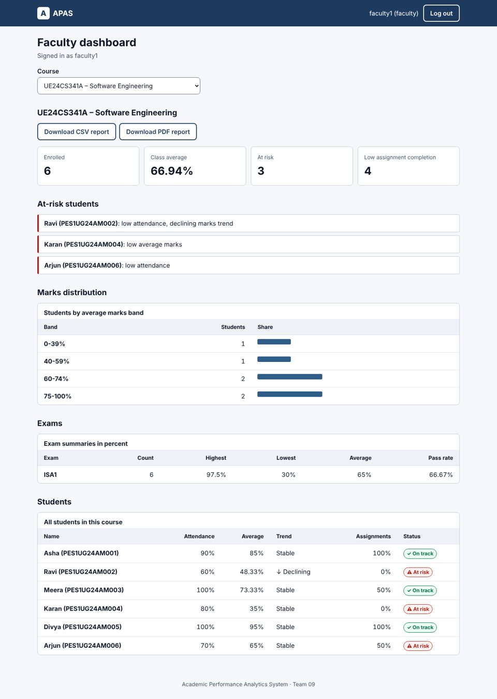
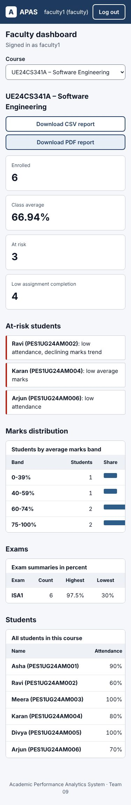
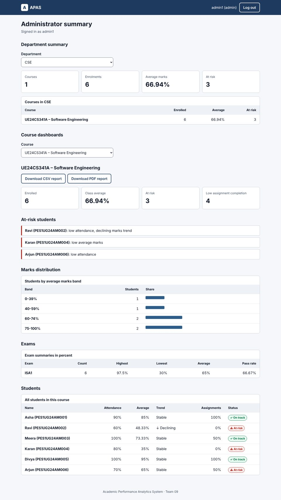
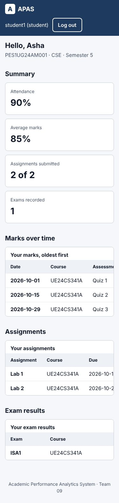
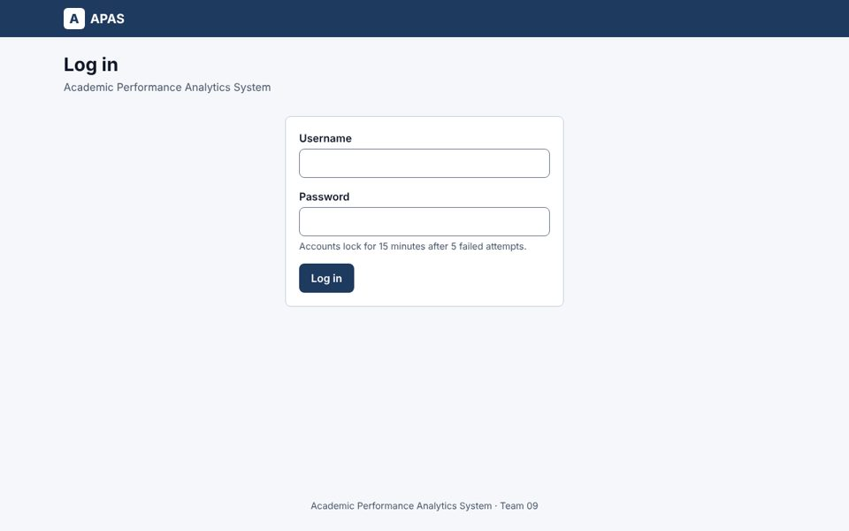

# APAS Accessibility and Responsiveness Audit (TC-UX-01)

**Requirement:** APAS-NF-004 – the user interface shall be responsive (desktop and mobile) and conform to WCAG 2.1 AA where applicable. Acceptance: the accessibility audit passes.
**Issue:** #51 · **Owner:** Pranav Kalla · **Date:** 11-11-2026 · **Result: PASS**

## What was audited

The web UI at `/app/` (`src/app/web/`): login, student dashboard, faculty course dashboard and administrator summary. It is plain HTML, CSS and JavaScript served by FastAPI and calls the existing REST API, so no frontend build step is needed.

Run it locally:

```bash
python -m scripts.seed_demo        # once, on an empty database
uvicorn src.app.main:app --reload  # then open http://127.0.0.1:8000/
```

## Method

1. **Automated audit** with axe-core 4.10.2 (`scripts/a11y_audit.py`), WCAG 2.1 A and AA rule sets, on all four pages at 1280 px (desktop) and 375 px (mobile), logged in with the demo accounts. The script also checks that the page never scrolls sideways (WCAG 1.4.10 Reflow).
2. **Keyboard check**: the whole flow (log in, wrong password, log in, choose a course, download a report, log out) done with Tab, Shift+Tab and Enter only.
3. **Regression tests** in CI: `tests/test_web_ui.py` (12 tests) checks the language, title, viewport, landmarks, skip link, labels, table headers, focus style, non-colour status, CSP and that server data is never parsed as HTML.

## Results

| Page | Width | WCAG rules passed | Violations | Sideways scroll |
|---|---|---:|---:|---|
| Login | 1280 px | 23 | 0 | No |
| Student dashboard | 1280 px | 22 | 0 | No |
| Faculty dashboard | 1280 px | 26 | 0 | No |
| Administrator summary | 1280 px | 26 | 0 | No |
| Login | 375 px | 23 | 0 | No |
| Student dashboard | 375 px | 23 | 0 | No |
| Faculty dashboard | 375 px | 27 | 0 | No |
| Administrator summary | 375 px | 27 | 0 | No |

**Keyboard check:** Tab order is skip link → username → password → Log in. A wrong password shows "Invalid username or password" in an alert and puts focus back on the password field. After login, focus moves to the new page heading so screen readers announce it. Course and department pickers are native `<select>` elements; report downloads are links. No keyboard traps.

## How the UI meets WCAG 2.1 AA

| WCAG criterion | How it is met |
|---|---|
| 1.1.1 Non-text content | Decorative bars are `aria-hidden`; every bar has its number in the same table row |
| 1.3.1 Info and relationships | Headings in order (h1, h2), `<table>` with `<caption>` and `scope` on headers, labelled form fields, landmarks (header, nav, main, footer) |
| 1.3.5 Identify input purpose | `autocomplete="username"` and `current-password` |
| 1.4.1 Use of colour | Status uses text and a symbol ("⚠ At risk", "✓ On track", "↓ Declining"), not colour alone |
| 1.4.3 Contrast | All text is at least 4.5:1 (body #101828 on #f5f7fa, muted #475467, risk #b42318 on #fef3f2) |
| 1.4.4 / 1.4.10 Resize and reflow | Viewport allows zoom; layout reflows to 375 px; wide tables scroll inside their own labelled region |
| 2.1.1 Keyboard | Only native controls (button, link, select, input) |
| 2.4.1 Bypass blocks | "Skip to main content" link is the first Tab stop |
| 2.4.2 Page titled | Title changes per view, e.g. "Faculty dashboard – APAS" |
| 2.4.7 Focus visible | 3 px focus outline on every control |
| 2.5.5 Target size | Buttons and inputs are at least 44 px tall |
| 3.1.1 Language of page | `<html lang="en">` |
| 3.3.1 / 3.3.2 Errors and labels | Visible labels; errors in `role="alert"` |
| 4.1.3 Status messages | Loading and loaded messages in a `role="status"` live region |

Security: the page has a Content Security Policy (`script-src 'self'`, no inline scripts or styles), and all server data is added as text, never as HTML.

## Screenshots

| Desktop | Mobile (375 px) |
|---|---|
|  |  |
|  |  |



## Limits

- Automated tools find about half of WCAG issues; the keyboard check covers the rest that matter most here. A full screen-reader test (NVDA or VoiceOver) was not done.
- Charts are simple bars inside tables; there is no separate chart library.
- Upload screens (CSV marks and attendance) are API-only and not part of this UI.
